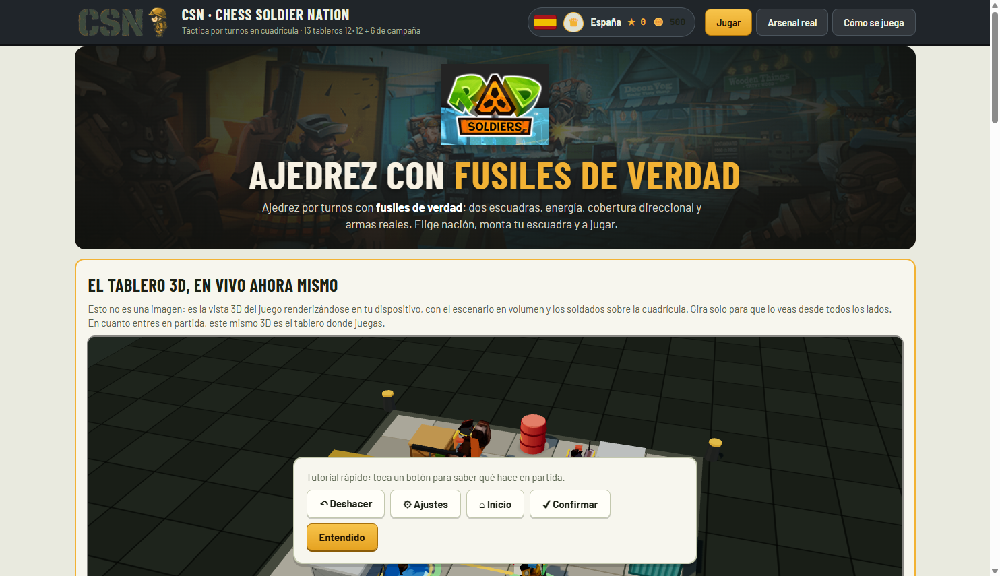

# Capturas 3D de los mapas (base reconocible)

_La portada: arte y logo del RAD Soldiers original sobre la que se construye
CSN, con el tablero 3D en vivo debajo._

Capturas reales del juego en vista 3D (`_capture_all.mjs` con
`Page.bringToFront`), tomadas tras las fases F0-F9 y las rondas del plan
director. Los triangulos y llamadas salen de `window.__csn3d`.

| Mapa | id | Triangulos | Llamadas | Captura |
|---|---|---|---|---|
| Skirmish_03 - Londres | `skirmish03` | 79040 | 558 | [png](capturas/REAL_skirmish_3d.png) |
| Skirmish_05 - El deposito | `depot` | 65069 | 555 | [png](capturas/REAL_skirmish05_3d.png) |
| Skirmish_08 - La terminal | `terminal` | 80871 | 504 | [png](capturas/REAL_skirmish08_3d.png) |
| Skirmish_11 - El astillero | `astillero` | 73551 | 574 | [png](capturas/REAL_skirmish11_3d.png) |
| Skirmish_06 - Los andenes | `platform` | 70239 | 556 | [png](capturas/REAL_skirmish06_3d.png) |
| Skirmish_09 - La rotonda | `rotonda` | 72139 | 546 | [png](capturas/REAL_skirmish09_3d.png) |
| Skirmish_04 - El puente | `skirmish04` | 78088 | 544 | [png](capturas/R4_sk04_3d.png) |
| Skirmish_10 - El cruce | `cruce` | 71344 | 556 | [png](capturas/R5_skirmish10_3d.png) |
| Skirmish_01 - La plaza | `plaza` | 33488 | 567 | [png](capturas/R6_skirmish01_3d.png) |
| Skirmish_02 - El embarcadero | `dock` | 33392 | 564 | [png](capturas/R6_skirmish02_3d.png) |
| Skirmish_07 - El mercado | `market` | 33272 | 562 | [png](capturas/R6_skirmish07_3d.png) |
| Campana - Mision 1 (Almacen) | `warehouse` | 33282 | 543 | [png](capturas/CAM_M1_3d.png) |
| Campana - Mision 2 (Patio) | `yard` | 32998 | 547 | [png](capturas/CAM_M2_3d.png) |
| Campana - Mision 3 (Londres) | `skirmish03` | 81076 | 566 | [png](capturas/CAM_M3B_3d.png) |
| Campana - Mision 4 (El puente) | `skirmish04` | 78280 | 557 | [png](capturas/CAM_M4_3d.png) |
| Campana - Mision 5 (Ultima guardia, 5v5) | `warehouse` | 39748 | 625 | [png](capturas/CAM_M5_3d.png) |
| Campana - Mision 6 (El convoy, escolta 5v5) | `cruce` | 78780 | 649 | [png](capturas/CAM_M6_3d.png) |
| Almacen industrial (baliza) | `warehouse` | 33290 | 549 | [png](capturas/ALM_3d.png) |
| Campana mision 1 (tablero propio) | `plaza` | 32846 | 542 | [png](capturas/CAM_N1.png) |
| Campana mision 4 (tablero propio) | `warehouse` | 32374 | 518 | [png](capturas/CAM_N4.png) |
| Campana mision 2 (tablero propio) | `market` | 30946 | 523 | [png](capturas/CAM_N2.png) |
| Campana mision 3 (tablero propio) | `dock` | 32534 | 503 | [png](capturas/CAM_N3.png) |
| Campana mision 5 (tablero propio, 5v5) | `yard` | 38864 | 601 | [png](capturas/CAM_N5.png) |
| Campana mision 6 (El convoy, escolta 5v5) | `dock` | 40006 | 617 | [png](capturas/CAM_N6.png) |
| Patio de contenedores (baliza) | `yard` | 33006 | 550 | [png](capturas/PAT_3d.png) |

Notas:
- Los mapas de codigo (skirmish01/02/07) usan losas, por eso tienen menos
  triangulos que los mapas con geometria real del IPA (`geo:true`).
- Las capturas se han verificado con `units:8` (escuadras completas) y con
  `vistaClasica:"skip"`: son 3D, no la vista clasica.
- La vista 2D es una alternativa accesible y no se usa como verificacion.

## Campana en 3D

Las dos capturas de campana se tomaron arrancando la mision desde el
capturador (`node _capture_all.mjs campana:2 CAM_M3B`), que hace
`openSetup('campana',N)` y pulsa el boton de jugar. Verificado con
`units:8` y `vistaClasica:"skip"`; el HUD muestra la ronda, el mapa, el
modo y la dificultad de la mision.

La mision 6 se captura con 10 unidades (5 contra 5) y el dron de escolta
en juego: confirma que el objetivo escolta funciona dentro de la campana.

## Tableros propios de campana

Las seis misiones de campana tienen ya tablero propio (campana01..06), con
layout unico y simetria 180 comprobada por `bench/boards.js` (19 tableros en
total). Las tres capturas de campaña de la tabla se tomaron arrancando la
mision desde el capturador (`campana:N`); las seis se han jugado ademas en el
motor con `bench/harness.js` (12 partidas, sin fallos).

Las seis misiones de campana estan capturadas en 3D sobre su tablero propio
(misiones 1 a 6 en `CAM_N1.png` ... `CAM_N6.png`).
